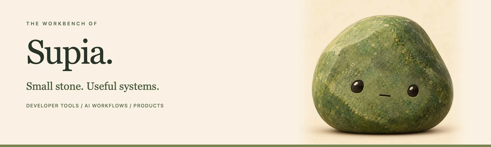

  

### Hi, I'm Supia.

I build **developer tools, AI workflows, and products at MORI**.
I like making complicated work feel a little simpler — one useful tool at a time.

[MORI](https://github.com/MoriProject) · [Repositories](https://github.com/Supia7?tab=repositories)

---

### On my workbench

**Developer tools** Small, focused tools that remove friction from everyday work.

**AI workflows** Connecting agents, context, and real work into systems I can actually use.

**Product building** Working across code, design, and operations to turn ideas into usable products.

### A small thing I've built

#### [QuotaBar](https://github.com/Supia7/quota-bar)

A native macOS menu-bar monitor for Claude and Codex subscription usage.
Remaining quota, multiple accounts, and reset times — without opening another dashboard.

`Swift` · `macOS` · `Developer tools`

---

  Stay curious. Build useful things. Keep it grounded.

