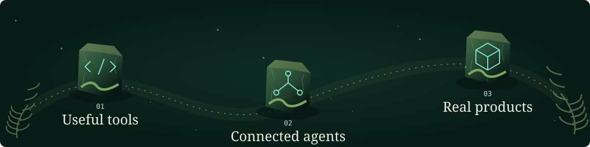
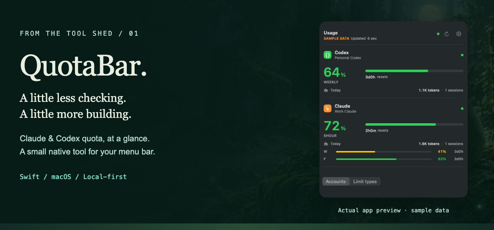
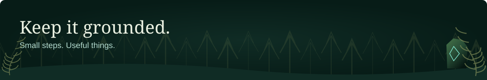

  <picture>
    <source media="(max-width: 600px)" srcset="./assets/supia-forest-hero-mobile.png">
    <source media="(prefers-reduced-motion: reduce)" srcset="./assets/supia-forest-banner.png">
    
  </picture>

<a href="./assets/supia-forest-banner.png">Still version</a>

## Welcome to my corner of the forest.

I'm **Supia**. I build developer tools, connect AI agents to real work, and build products at **MORI**.
I like small tools that make complicated work feel a little simpler.

[Explore the tool shed](#the-tool-shed) · [Walk through the garden](#the-moss-garden) · [Browse my repositories](https://github.com/Supia7?tab=repositories)

## The paths I keep taking

<picture>
  <source media="(max-width: 600px)" srcset="./assets/workbench-trail-mobile.svg">
  
</picture>

- **Useful tools:** less context switching, fewer repetitive steps.
- **Connected agents:** context and workflows that lead to work I can actually use.
- **Real products:** code, design, and operations brought together at [MORI](https://github.com/MoriProject).

## The tool shed

<a href="https://github.com/Supia7/quota-bar">
  <picture>
    <source media="(max-width: 600px)" srcset="./assets/quotabar-exhibit-mobile.png">
    
  </picture>
</a>

### [QuotaBar](https://github.com/Supia7/quota-bar)

A little less checking. A little more building.

Remaining Claude and Codex subscription quota, multiple accounts, and reset times, right in the macOS menu bar.
Built with **Swift**, with OAuth credentials stored in the **macOS Keychain**.

[View the source](https://github.com/Supia7/quota-bar) · [Get the latest release](https://github.com/Supia7/quota-bar/releases/latest)

The exhibit uses the project's public preview with sample data. It is not a live usage widget.

## The moss garden

Every patch is a day. A little work leaves a little green behind.

<picture>
  <source media="(max-width: 600px)" srcset="./assets/contribution-garden-mobile.svg">
  
</picture>

<!-- garden:start -->

**142 contributions** across **365 days**, 2025-10-14 through 2026-10-13. Updated 2026-10-13 (UTC).

Each tile represents one day. Bare soil, moss, sprouts, ferns and trees encode GitHub's five contribution levels. Contributions are not commits or a productivity score. Private contributions may be excluded by the API or token scope.

[Raw calendar](./data/contribution-calendar.json) · [Garden renderer](./scripts/contribution-garden.mjs)
<!-- garden:end -->

The garden refreshes daily from GitHub's GraphQL calendar, not a scrape of the graph below.
GitHub's API and profile graph can group some activity on different dates; the original calendar stays unchanged.

How this garden grows

- One soil tile for every day returned by GitHub, including the partial weeks.
- Five growth stages follow GitHub's own contribution levels.
- The phone layout splits the same full calendar into smaller plots.
- No external stats widget, tracking pixel, or made-up streak.

[Calendar data](./data/contribution-calendar.json) · [Garden source](./scripts/contribution-garden.mjs) · [Refresh workflow](./.github/workflows/contribution-garden.yml)

 

<picture>
  <source media="(max-width: 600px)" srcset="./assets/forest-footer-mobile.svg">
  
</picture>

  <strong>Small stone. Useful systems.</strong> 
  <a href="https://github.com/Supia7?tab=repositories">Explore my work</a> · <a href="https://github.com/MoriProject">Visit MORI</a>

